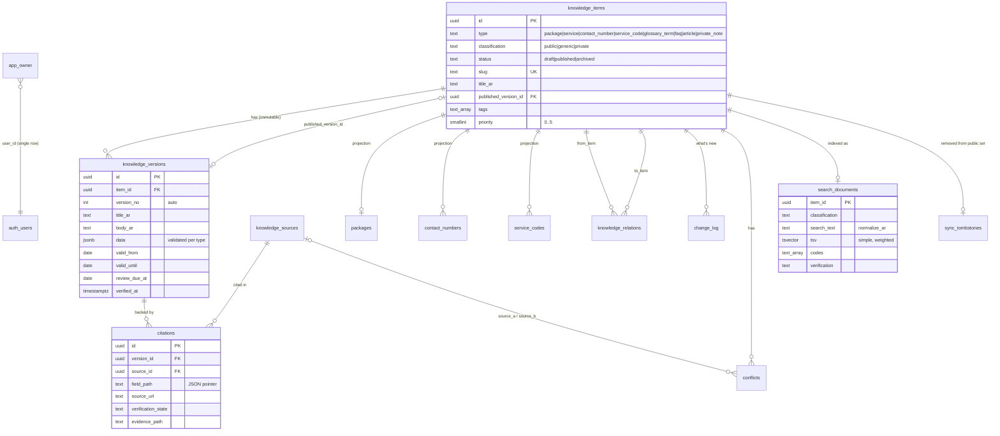

# Database (Supabase / PostgreSQL)

Status: **written but never executed.** This machine has no Supabase CLI, Docker or psql, so the migrations and pgTAP tests have never been run. Run `supabase test db` before you trust any of this.

Source of truth for the design: `docs/discovery/00-foundation.md` (owner decisions v0.2, §11) and `docs/discovery/03-technical-architecture.md` §3, §4 and §6. Where they conflict, v0.2 wins:

- Readers use the **anon key and never log in**.
- **One owner account** writes everything. There are no roles, employees or branches tables.
- The workflow is **draft → published → archived**. "Review" is just the `verified_at` and `review_due_at` fields.
- Bookmarks, progress and history stay **on the device** (local SQLite), not in this database.

## Files

| Path | What |
|---|---|
| `supabase/config.toml` | Minimal local CLI config. Sign-ups are disabled and only `public` and `graphql_public` are exposed |
| `supabase/migrations/20261123000100_extensions_normalizer_owner.sql` | `pg_trgm`, the `app` schema, `normalize_ar`/`normalize_code`/`normalize_number`, `app_owner`, `is_owner()` |
| `supabase/migrations/20261123000200_content_schema.sql` | All tables and indexes |
| `supabase/migrations/20261123000300_triggers_and_publish.sql` | Validation, immutability, the publish pipeline, `publish_item`/`archive_item`/`reindex_all` |
| `supabase/migrations/20261123000400_search_and_sync.sql` | `search()` and `sync_since()` |
| `supabase/migrations/20261123000500_rls_and_grants.sql` | RLS policies and table/function grants |
| `supabase/tests/rls.test.sql` | pgTAP: visibility, write denial, owner powers, tombstones, immutability, validation |
| `supabase/tests/search.test.sql` | pgTAP: exact codes, normalization, typos, synonyms, ranking |
| `supabase/tests/normalize.test.sql` | pgTAP: the 50 shared fixture cases plus extra properties |
| `supabase/tools/gen_normalizer.py` | Regenerates the normalizer tables and fixture assertions, and runs a parity check |
| `supabase/seed.sql` | **FAKE** dev data. Load it locally only, never in production |

## ERD



## Tables

| Table | Kind | Notes |
|---|---|---|
| `app_owner` | config | A single row (`singleton` PK) holding the owner's `auth.users.id`. It has no API write policy |
| `knowledge_items` | authored | The spine. Display titles are copied from the version on publish. **Never hard-delete** an item once it has versions; archive it |
| `knowledge_versions` | authored, append-only | `version_no` is auto-assigned. `data` is validated per type. UPDATE, DELETE and TRUNCATE are rejected by triggers |
| `knowledge_sources` | authored | `classification public/private`. A private source can only back private items |
| `citations` | authored | One row per supported fact (`field_path` = JSON pointer, `/` = whole version) |
| `packages`, `contact_numbers`, `service_codes` | derived | Rebuilt from the published version's `data` on every publish. Removed on archive. Codes and numbers are stored **normalized** for exact lookup |
| `knowledge_relations` | authored | Typed edges. Readers see an edge only when both ends are public |
| `change_log` | derived | `_published`, `_archived`, and a per-field diff (`title_ar`, `data.price`, …) between consecutive published versions |
| `conflicts` | authored | Open conflicts set the item's verification to `conflict` and demote it in search |
| `synonyms` | authored | `term` and `variants[]` are stored normalized (trigger). Expanded at query time |
| `search_documents` | derived | One row per published item, including private ones, which RLS hides |
| `sync_tombstones` | derived | Item ids that left the public set (archived or reclassified). They carry no reason or title |

### Per-type `data` validation (trigger, on insert)

| Type | Required | Optional |
|---|---|---|
| `package` | `price` (number ≥ 0), `price_tax_basis` (`incl_vat`/`excl_vat`/`unknown`), `currency` (3 uppercase letters), `validity_days` (positive int) | `subscribe_code` (string with digits), `line_type` (`prepaid`/`postpaid`/`control`/`home`/`other`) |
| `contact_number` | `service` (string), `numbers[]` (non-empty; each `{number, from_network: own/other/landline/abroad}`) | `numbers[].hours`, `numbers[].cost_note` |
| `service_code` | `code` (string with digits), `purpose` | — |
| any | — | `codes[]`: `{code, purpose?}`, also projected into `service_codes` |

Invalid data raises SQLSTATE `22023`.

### Workflow

- New items are always inserted as `draft`.
- `publish_item(item, version)` and `archive_item(item)` are owner-only RPCs. A direct `UPDATE … set status` by the owner goes through the same triggers.
- Allowed moves: draft→published, published→published (a new version), published→archived, archived→draft/published. **published→draft is rejected**: archive instead, so offline readers get a tombstone.
- Publishing a version copies its titles to the item, rebuilds the projections and the search document, writes `change_log`, and clears or creates tombstones.
- Publishing a `public`/`generic` item that cites a `private` source fails. So does turning a cited source private.
- Editing flow with immutable versions: the editor keeps the working copy locally and inserts a version only when you save a checkpoint or publish.

## Reclassification and history (no leaks)

Reclassifying an item private → public intentionally exposes its **current** published version, with its citations, projections, search document and relations. Nothing older is exposed:

- Old versions are never readable by anon. Only `published_version_id` is.
- `change_log.recorded_public` is frozen when the row is written:
  - `_published` rows are public only if the item was public/generic at that moment.
  - Field diffs carry old values, so they are public only if the item was **already public before** that update and still is. A version published while private, or the same update that reclassifies the item and switches its version, stays owner-only forever.
- `conflicts.recorded_public` is set by a trigger on every insert or update: true only if the item was public/generic at that moment. A conflict written while the item was private stays hidden after reclassification until the owner re-saves it. It also doesn't count toward the item's `has_open_conflict` / `conflict` flag or the `sync_since` payload.
- `sync_tombstones` hold ids only. `search_documents`, projections and relations always reflect the current state.
- Citations attached to the current version become visible on reclassification, just like the version body. A private source can never be cited by a non-private item.

## RLS matrix

RLS is **enabled on every table** but not forced. The table owner (the migration role) must bypass RLS so the SECURITY DEFINER triggers can maintain the derived tables and `is_owner()` can read `app_owner` without recursion. `anon` and `authenticated` never own tables.

| Table | anon / authenticated non-owner: SELECT | anon: write | non-owner authenticated: write | owner |
|---|---|---|---|---|
| `knowledge_items` | `status='published' AND classification IN (public, generic)` | no grant | grant exists, but the trigger/RLS rejects it (42501 / 0 rows) | all |
| `knowledge_versions` | only the **currently published** version of such items | no grant | INSERT rejected; no UPDATE/DELETE grant | SELECT + INSERT only (immutable) |
| `citations` | citations of that published version | no grant | rejected | all |
| `knowledge_sources` | `classification='public'` | no grant | rejected | all |
| `packages` / `contact_numbers` / `service_codes` | rows of public items | no grant | no grant | SELECT (trigger-maintained) |
| `knowledge_relations` | both ends public | no grant | rejected | all |
| `change_log` | `recorded_public` rows of public items | no grant | no grant | SELECT |
| `conflicts` | `recorded_public` rows of public items | no grant | rejected | all |
| `synonyms` | all | no grant | rejected | all |
| `search_documents` | `classification IN (public, generic)` | no grant | no grant | SELECT (all, including private) |
| `sync_tombstones` | all (ids only) | no grant | no grant | SELECT |
| `app_owner` | anon: none; authenticated: own row only | no grant | no grant | SELECT own row; set it from the SQL editor |

RPCs:

| Function | Security | Granted to |
|---|---|---|
| `search(q, filter_types, lim)` | INVOKER (RLS applies before ranking and snippets) | anon, authenticated |
| `sync_since(ts)` | INVOKER, plus an explicit public/generic filter (private content is never exported, even to the owner) | anon, authenticated |
| `normalize_ar`, `normalize_code`, `normalize_number`, `is_owner` | — | anon, authenticated |
| `publish_item`, `archive_item`, `reindex_all` | check `is_owner()` | authenticated |
| `app.*` helpers and trigger functions | DEFINER, `search_path=''` | only the policy helpers are granted to anon/authenticated |

## Setting the owner

1. Create the owner's user in the Supabase dashboard (**Authentication → Users → Add user**). Use a strong password and turn on MFA.
2. In the SQL editor, run:
   ```sql
   insert into public.app_owner (user_id) values ('<the user id>');
   ```
   The table has a single-row primary key, so a second owner is impossible. To change the owner, `delete from public.app_owner;` and insert again.

## IMPORTANT: disable public sign-ups

Anyone who can create an account becomes `authenticated`. RLS still denies them everything beyond what anon can read, and the tests prove that. Even so, **public sign-ups must be OFF**:

- Hosted project: **Authentication → Sign In / Providers → turn off "Allow new users to sign up"**, and also turn off anonymous sign-ins and any OAuth providers you don't use.
- Local: `supabase/config.toml` already sets `[auth] enable_signup = false` and `[auth.email] enable_signup = false`.

Never ship the `service_role` key in the app. The app only needs `SUPABASE_URL` and the anon/publishable key.

## Search

- Normalization: `public.normalize_ar` is a **byte-for-byte mirror** of `lib/core/search/arabic_normalizer.dart`. That covers the rules in 03 §4.2 that the Dart side implements: the NFKC subset, invisible characters, tashkeel `U+064B–065F` + `U+0670` + Quranic marks, tatweel, alef/yeh/teh marbuta/hamza-carrier/keheh folding, digits, `، ؛ ؟ → , ; ?`, Latin lowercasing, collapsing runs of 3+ identical Arabic letters, and whitespace. It deliberately avoids `lower()` and `normalize(NFKC)`, so the result does not depend on the database locale.
- `normalize_code(t)` = normalized text keeping only `0-9 * # +`. `normalize_number(t)` = digits only. Country codes are not rewritten (`+20 100…` → `20100…`). The Dart query classifier must do the same.
- `search_documents.tsv` uses the `'simple'` config over normalized text: title + tags = A, summary = B, body + data values + codes = C. `search_text` gets `gin_trgm_ops`.
- `search()` steps:
  1. If the whole query looks like a code or number, an exact `codes @>` match is pinned (+1000).
  2. FTS with prefix matching and synonym OR-expansion, with tokens ANDed (weight 1.0) and also ORed (0.5).
  3. Trigram matching: `greatest(similarity(q,title_norm), word_similarity(q,search_text)) ≥ 0.3` (weight 0.6).
  4. Results are merged with RRF (k=60).
  5. Expired items are multiplied by 0.3, conflict items by 0.7, and priority adds a boost of ×(1+0.05·p).
- `snippet` is `ts_headline` over the display text with `<mark>…</mark>` markers. Highlights can be missing where the display spelling differs from the normalized spelling (ة/ه). The client may re-highlight with the Dart normalizer.

### Normalizer parity

When `arabic_normalizer.dart` or `test/core/search/fixtures/normalizer_cases.json` changes:

```bash
python -I supabase/tools/gen_normalizer.py   # must print 0 mismatches
```

Then paste `supabase/tools/out/translate_from.sql` and `translate_to.sql` into a **new** migration that replaces `public.normalize_ar`. Replace the fixture block in `supabase/tests/normalize.test.sql`, then call `select public.reindex_all();` as the owner. `gen_normalizer.py` keeps its own Python copy of the Dart lookup table, so update it as well.

## Offline sync

`sync_since(ts)` returns rows of four kinds:

- `item`: the full payload, with the published version, projections, citations, relations to public items and open conflicts.
- `tombstone`: delete this item locally.
- `synonyms`: the full dictionary.
- `meta`: the `server_time` to use as the next `ts`.

With `ts = null` you get a full snapshot: replace the local store. Pass the previous `server_time` minus a few minutes, because commits can land after their `now()`. Upserts are idempotent.

## Running the tests

```bash
supabase start          # needs Docker
supabase db reset       # applies migrations + seed.sql (local only)
supabase test db        # runs supabase/tests/*.test.sql (pgTAP)
```

## Known risks / unverified

- **Nothing has been executed.** Expect a few syntax or semantic fixes on the first `supabase db reset`.
- `pg_trgm` and Arabic: trigram extraction depends on the database ctype. With plain `C` it yields no Arabic trigrams, so typo tolerance silently stops working. `search.test.sql` asserts `show_trgm('باقه')` is non-empty.
- `app.is_privileged_writer()` treats any session whose `role` GUC is not `anon`/`authenticated` as privileged (SQL editor, seed, service_role). This assumes PostgREST sets the `role` GUC, which it does.
- `current_date` is evaluated in the DB time zone (UTC on Supabase), not `Africa/Cairo`, so expiry can flip up to about 3 hours off.
- No pagination in `sync_since`. That is fine for personal scale (thousands of items).
- Trigram matching scans every search document (`word_similarity` over `search_text`). That is fine for thousands of rows; revisit at scale.
